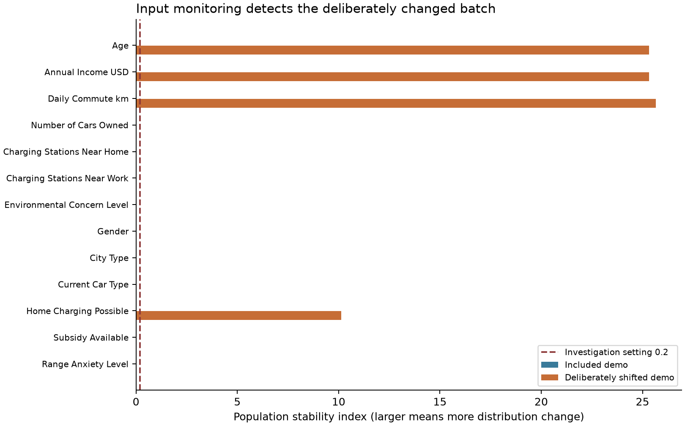

# Input monitoring

The project checks whether a new customer batch differs from its training
population. This complements input validation and model version checks. It
does not establish that predictions are accurate or that customers will buy.

## Run the demonstration

Complete the main README setup with Python 3.12 or 3.13 and keep the environment
active. From the project folder, run the following command on Mac or Windows.
The saved reference and demo are included, so this demonstration does not need
a Kaggle download or a training run.

```bash
python -m ev_project.monitoring --demo
```

Expected messages

**Baseline: stable; shifted batch: investigate.**<br>
**Investigate: Age, Annual_Income_USD, Daily_Commute_km, Home_Charging_Possible.**

The demonstration compares the included 500 synthetic profiles with copies
whose age, income, commute distance, and home charging availability are
deliberately changed. Both inputs pass the shared schema. The deliberately
changed records are generated in memory and are never saved as customer data.

The command saves `demo_baseline.json`, `demo_shifted.json`,
`demo_summary.json`, and `drift_demo.png` under `docs/reports/monitoring/`.
Reports contain aggregate counts and no profile records, IDs, or outcomes.
The model stays unchanged.



*The included demo has a maximum feature PSI of 0.01828. The deliberately
shifted batch reaches 25.65753, with four features exceeding the investigation
setting. This confirms that the detector responds to this constructed shift;
it does not estimate false alert rates or prove detection of every shift.*

## Monitor another batch

Use a CSV with the same headers as `data/demo/customer_profiles_template.csv`.

```bash
python -m ev_project.monitoring --input data/demo/customer_profiles_demo.csv --output docs/reports/monitoring/latest_batch.json
```

Expected message for this example

**Monitoring status: stable (500 rows).**

The API also returns this aggregate monitoring report with each successful
ranking response. The service does not retain raw requests or append them to
a dataset. A caller can save the returned aggregate report for a monitoring
history; the CLI explicitly saves a report at the requested path.

## Reference provenance and model version

`models/monitoring_reference.json` contains histogram counts and numeric bin
boundaries from the **468,065 rows in the saved training split**. Validation
and holdout features and all target labels are excluded from reference fitting.
The source dataset and split membership hashes are recorded. Before rebuilding,
the cleaned source hash and split counts must match the saved model metadata.
Saved membership assignments must also reproduce the original stratified
split seed. Labels are read only to verify those split identities, then are
excluded from histogram fitting.

The reference contains the SHA256 digest of `models/model_bundle.joblib`, its
feature schema version, construction time, and an integrity digest over the
reference contents. A missing, changed, malformed, or incompatible reference
is rejected. The digest detects accidental edits; it is not a signed artifact.

If training replaces the model, reproduce the EDA and modeling steps first,
then rebuild the reference explicitly.

```bash
python -m ev_project.monitoring --build-reference
python -m ev_project.monitoring --demo
```

Rebuilding requires local `data/processed/train_clean.csv` and
`data/splits/split_membership.csv`, which are created by the documented
analysis workflow. A rebuilt model can legitimately change hashes or scores;
inspect its evaluation before accepting it. The old reference must not be
silently reused with a replacement model.

## Measures and investigation settings

Numeric features use frozen training quantiles, with separate lower and upper
tail bins. Tied quantiles are merged. Categorical features use the fixed shared
schema categories. Every validated record enters exactly one bin per feature.
Outside-training-range counts are reported separately; valid values are
retained without clipping.

The population stability index (PSI) is the sum over bins of
`(current_share - reference_share) * ln(current_share / reference_share)`.
Each proportion is floored at `0.000001` and normalized again so zero-frequency
bins remain finite. This is a distribution measure and is not a significance
test. The [Evidently documentation](https://docs-old.evidentlyai.com/user-guide/customization/options-for-statistical-tests)
describes PSI as a selectable numerical and categorical drift measure.

| Setting | Project behavior |
|---|---|
| Fewer than 200 rows | `insufficient_data`; descriptive counts and PSI are provided, without a drift decision |
| Every feature PSI below 0.1 | `stable` |
| Any feature PSI from 0.1 to below 0.2 | `review`, unless another feature requires investigation |
| Any feature PSI at least 0.2 | `investigate` |
| Invalid schema, missing values, unsupported categories, or duplicate IDs | Reject input before scoring or drift reporting |
| Replaced model or broken reference integrity | Reject monitoring until the artifacts are reconciled |

These are **prototype design settings**. The batch minimum and alert thresholds
are not calibrated for a real dealership, do not control a false alarm rate,
and should be reviewed using representative historical batches before use.

For a review or investigation signal, check source systems, units, category
coding, data collection changes, and customer mix. Compare repeated batches
and review affected groups. Request verified, consented outcomes before
deciding whether the model remains useful or should be changed. No alert
automatically retrains, replaces the model, or contacts a customer.

## Limits and verification

Marginal feature histograms can miss changes in relationships among features,
and stable inputs can still have declining accuracy. Drift does not prove
an error or a need to retrain. No observed outreach outcomes exist, so this
implementation does not claim to monitor real purchase quality, fairness,
sales, or return on investment.

Focused tests cover stable inputs, numeric tails, categorical changes, small
batches, invalid profiles, stale model versions, malformed references,
training-only membership, heldout exclusion, and finite zero-bin behavior.

```bash
python -m unittest discover -s tests -p "test_monitoring.py" -v
```

Expected final result is **OK**. The measured local run passed **10 tests**;
runtime varies by computer. The monitoring demo does not modify the fitted
model or the EDA/model evaluation files.
