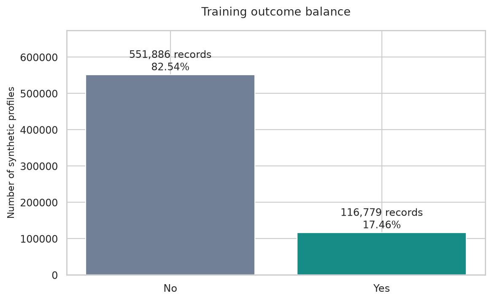
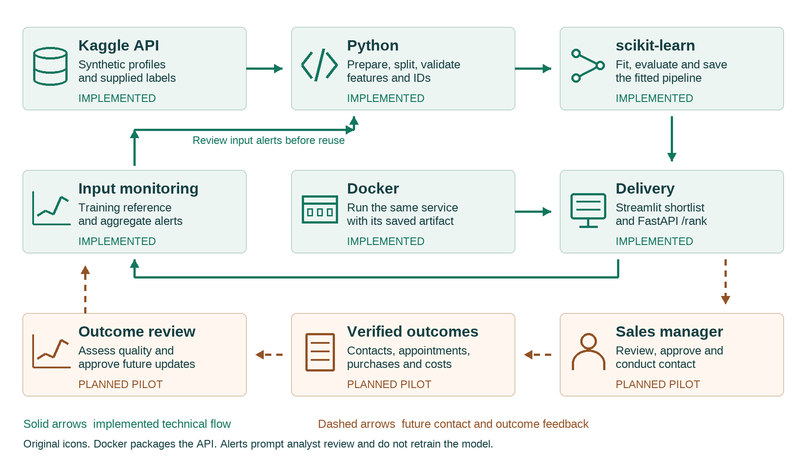
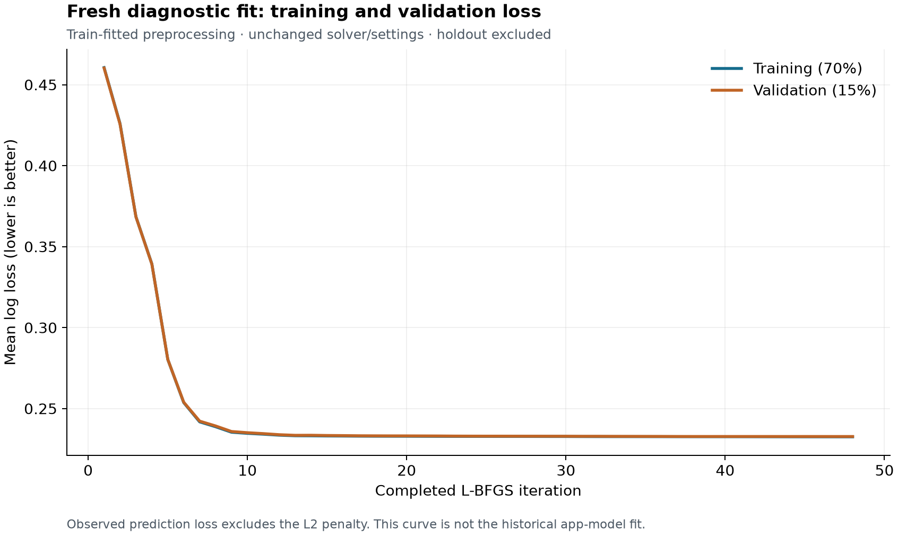
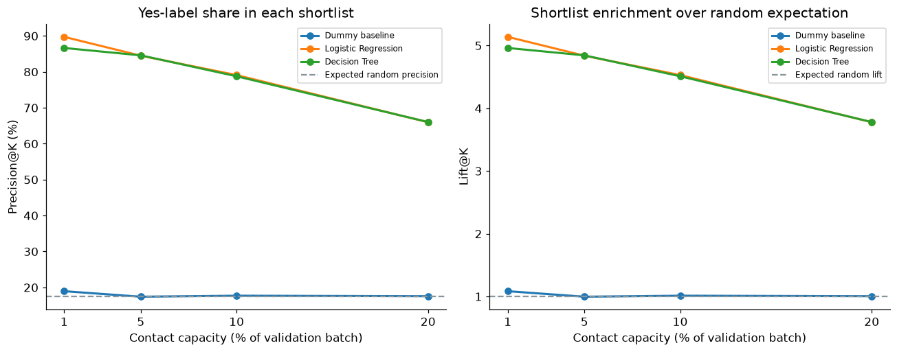
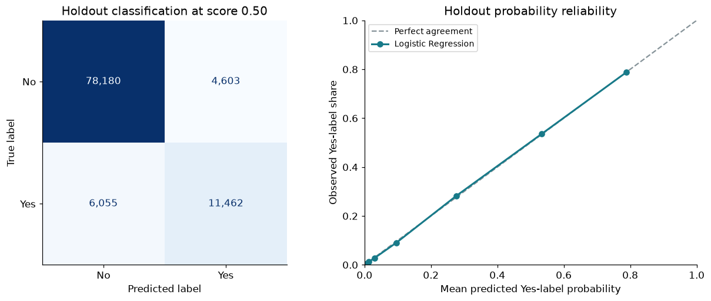
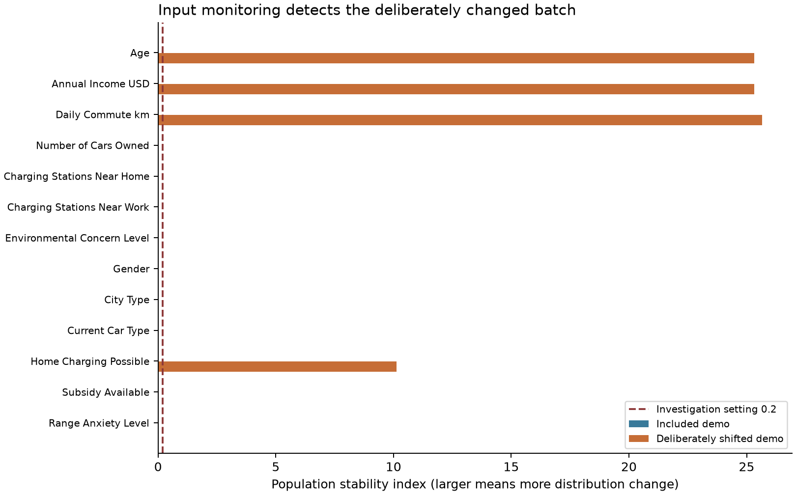

# EV Customer Prioritization Final Report

**Nu Quynh Chau Nguyen | MSBA265 Applied Analytics | Fall 2026**

**A reproducible prototype for allocating limited dealership outreach capacity**

## 1 Executive summary

An illustrative EV dealership has 1,000 customer profiles and capacity to contact 50 per campaign. This project asks which profiles staff should review first. It delivers a ranked shortlist, recorded customer facts, editable conversation guides, and reproducible scoring through a saved model. The sales manager chooses the contact capacity and retains responsibility for reviewing the shortlist and contacting customers.

The analysis compares Logistic Regression, a bounded Decision Tree, and a constant-score baseline on synthetic Kaggle profiles. Logistic Regression is selected using validation lift at the prespecified 10% contact capacity. The selected pipeline is refitted on training plus validation data and evaluated on a separate 100,300-profile holdout set.

At 5% capacity, matching 50 of 1,000 in the scenario, the holdout shortlist contains **4,246 Yes labels among 5,015 profiles, or 84.67%**. A random shortlist of equal size would average about **876 Yes labels, or 17.46%**. At the primary 10% capacity, the model finds **7,902 Yes labels among 10,030 profiles, or 78.78%**, equivalent to **4.51 times** the expected random concentration. These figures measure agreement with supplied synthetic labels. They do not measure real purchases or the effect of outreach.

The recommendation is to use the prototype to rehearse the workflow and design a controlled pilot with permitted dealership data. The tool gives staff a repeatable capacity rule and a consistent handoff. Real commercial use requires confirmed outcomes, a demographic fairness review, contact consent, and comparison against the dealership's existing process at equal staff capacity.

## 2 Business context and objective

**Which customers should an EV dealership prioritize for contact when its outreach capacity is limited?** The intended stakeholder is a sales or customer relationship manager deciding how to allocate a campaign's staff time. The analyst's task is to test a reproducible selection rule and deliver a shortlist that staff can inspect and use.

The business scenario assumes 10 minutes per contact and $30 per staff hour. Fifty contacts require 500 minutes, or 8 hours 20 minutes, and represent $250 in contact labor. This is $5 per contact. These are illustrative planning assumptions, not measured operating costs. They exclude analyst effort, application maintenance, facilities, incentives, and other campaign costs.

Success has three parts. First, the ranking should concentrate more supplied Yes labels than random selection at the same capacity. Second, an exported shortlist must contain exactly K profiles with the correct IDs, scores, and attached customer details. Third, another reviewer should be able to load the saved artifact and reproduce the scoring result. The statistical primary comparison is 10% capacity, fixed before candidate selection. The 5% result connects the evaluation to the 50-of-1,000 scenario.

A score estimates the dataset's `Will_Buy_EV = Yes` label. It does not establish a purchase timeframe or a causal benefit from contacting someone. The project therefore supports prioritization research and staff review rather than a sales forecast or profit commitment.

<!-- pagebreak -->

## 3 Individual project ownership

This individual project reflects an interest in applied analytics that connects a measurable question to an inspectable tool. My responsibilities cover problem framing, data interpretation, preparation choices, model comparison, evaluation, application review, and communication of the findings. The submitted notebooks, Python modules, saved artifact, reports, and presentation document that scope of work.

AI assistance supported code and document development. I remain responsible for understanding the submitted methods, reviewing generated material, checking numerical claims against the project records, and explaining the decisions and limitations. Automated tests provide technical evidence. Independent peer reproduction and the signed course validation form are separate handoff requirements.

## 4 Topic and industry context

The main topic is supervised binary classification. Each labeled profile contains predictors and a supplied Yes or No outcome. A continuous score allows the same fitted model to support different contact capacities. This fits the project question because the stakeholder needs an ordered list with a chosen size. Grouping similar customers would answer a different question, and the dataset does not contain the text or channel histories needed to make language or social-media analysis the central method.

Logistic modeling has a long research history. Berkson's 1944 paper applied the logistic function to biological responses, and Cox's 1958 work studied regression for binary sequences [3,4]. Those sources explain the method's lineage. They do not validate EV customer predictions. Modern implementation adds regularized fitting, reusable preprocessing, and explicit out-of-sample evaluation.

Predictive response models have also been studied in customer targeting. Moro, Cortez, and Rita compared models for bank telemarketing and evaluated their ordering with lift-based measures [5]. This supports the practical logic of examining a ranked list under limited capacity. Its results cannot be transferred numerically to this synthetic EV setting.

Driving needs and charging access are relevant consumer considerations in the U.S. Department of Energy's EV guidance [2]. The dataset contains commute, car ownership, charging availability, and range-anxiety fields. In the prototype, these recorded facts help staff prepare questions. They do not replace confirmation with the customer, verify a subsidy entitlement, or establish a suitable vehicle recommendation.

Potential value comes from a clearer review sequence and fewer manual handoff steps. Costs include data collection, staff review, analyst work, and maintenance. The project has not measured incremental appointments, purchases, or contribution margin. No cost saving or return on investment is claimed.

<!-- pagebreak -->

## 5 Data and preparation

### Source and record meaning

The source is Kaggle's *Predicting Electric Vehicle Purchases*, Playground Series Season 6 Episode 9 [1]. The download script uses the reviewer's own Kaggle account and `kaggle.json` credentials. Credentials remain outside version control. Competition terms govern access and reuse. The complete data dictionary and audit tables accompany the rendered analysis.

| Source file | Records | Cols | Analytical role |
|---|---:|---:|---|
| train.csv | 668,665 | 15 | Labeled development and evaluation |
| test.csv | 286,571 | 14 | Unlabeled scoring examples |
| sample_submission.csv | 286,571 | 2 | Competition submission template |

*Table 1. Source file roles. Source: `docs/reports/tables/file_summary.csv` and `docs/reports/data_manifest.json`. The unlabeled test file is not an extra performance-evaluation sample because it has no observed outcome.*

One row represents a synthetic customer profile with a unique `id`, 13 predictors, and, in the labeled file, `Will_Buy_EV`. The reversible mapping is No = 0 and Yes = 1. There are 116,779 Yes records, or 17.46%, and 551,886 No records. The ID supports traceability and deterministic tie handling but never enters prediction.

### Predictor interpretation

| Predictor group | Fields | Preparation and qualification |
|---|---|---|
| Demographic and financial | Age, Annual_Income_USD, Gender | Age and income are numeric; gender is categorical. These fields require necessity and fairness review before operational use. |
| Transport and charging | Daily_Commute_km, Number_of_Cars_Owned, Charging_Stations_Near_Home, Charging_Stations_Near_Work | Numeric fields. Commute direction, household unit, and charging radius are unspecified. |
| Context and reported attitudes | City_Type, Current_Car_Type, Home_Charging_Possible, Subsidy_Available, Range_Anxiety_Level, Environmental_Concern_Level | Categorical fields. Concern codes 1–5 are treated as nominal because survey anchors and equal spacing are unverified. |

*Table 2. The 13 model inputs. Source: `docs/reports/tables/data_dictionary.csv`, `ev_project/schema.py`, and `models/model_metadata.json`. Ambiguous field definitions limit how precisely staff can interpret an individual score.*

### Quality checks and retention decisions

The audit found zero missing or blank cells, duplicate IDs, duplicate full rows, repeated predictor profiles, non-finite numeric values, and checked domain violations in both source profile files. No source rows or predictor values were removed or changed. Preparation applies lossless integer storage where appropriate and the target mapping.

IQR checks flagged 3,678 income values, 41 commute values, and 13,489 car counts in the labeled data. These were retained because a statistical flag does not establish an error. Two unlabeled test commute values exceed the labeled data's 98.7 km maximum. The scoring path retains plausible numeric values and raises range warnings instead of treating the training range as customer eligibility.

<!-- pagebreak -->

### Development and evaluation boundaries

| Split | Profiles | Yes labels | Purpose |
|---|---:|---:|---|
| Training | 468,065 | 81,745 | Fit candidate preprocessing and estimators |
| Validation | 100,300 | 17,517 | Compare fixed candidates and select one |
| Holdout | 100,300 | 17,517 | Evaluate the final refitted pipeline |

*Table 3. Stratified 70/15/15 division. Source: `docs/reports/modeling/split_summary.csv` and `methodology.json`. Seed 42 creates the 70/30 split; seed 43 divides the remaining 30%. Each split has approximately 17.46% Yes labels.*

After model selection, the final pipeline is fitted on 568,365 training-plus-validation records. Holdout records remain excluded from fitting. During candidate comparison, fitted transformations use training data only. Validation and holdout receive transformation without fitting.

Descriptive exploration of the full labeled source occurred before splitting. The holdout therefore remains an internal evaluation within a known synthetic population. It is not a blind external validation. The source does not establish the purchase horizon, country, income definition, charging radius, or survey anchors. These limits cannot be resolved by increasing model complexity.



*Figure 1. Target balance across all 668,665 labeled source profiles in `train.csv`, before the 70%/15%/15% split. "Training" in the plot title refers to this source file, not the training partition. Source: `docs/reports/figures/02_target_balance.png` and `tables/target_summary.csv`. A method that always predicts No would achieve about 82.54% accuracy while identifying no Yes profiles. This motivates evaluation of a capacity-limited ranking rather than accuracy alone.*

<!-- pagebreak -->

## 6 Method and implementation

### From source records to staff review

The notebooks and Python modules prepare and evaluate the data. The saved scikit-learn pipeline performs the same fitted transformations whenever a valid new batch is scored. The Streamlit application shows the ranking, the first K profiles, recorded customer details, and five editable conversation-guide sections. Guide wording uses transport and charging facts. Editing a guide changes the staff handoff without changing the original ranking scores.



*Figure 2. Complete data-to-action workflow with original icons. The completed local prototype includes source access, preparation, saved-model scoring, application/API delivery, container packaging, and input monitoring. Dashed paths identify the proposed dealership outreach and verified-outcome feedback, which have not been carried out. The analyst investigates monitoring signals; staff review any shortlist before contact.*

<!-- pagebreak -->

### Candidate models and preprocessing

| Candidate | Fixed settings | Reason for inclusion |
|---|---|---|
| Dummy baseline | strategy = prior | Constant probability; tests whether profile features improve ranking |
| Logistic Regression | C = 1.0, L2 regularization, lbfgs, tol = 0.0001, max_iter = 1000 | Main compact classifier with continuous scores |
| Decision Tree | max_depth = 6, min_samples_leaf = 200, random_state = 42 | Bounded nonlinear comparison |

*Table 4. Prespecified candidates in `ev_project/modeling.py`. These settings define a limited comparison rather than an exhaustive search or proof of optimality. No resampling or class weighting is applied.*

Logistic Regression uses standardized numeric inputs and one-hot categorical encoding. The Tree and Dummy retain unscaled numeric inputs. The `ColumnTransformer` and estimator are saved as one pipeline. Encoding uses `handle_unknown="ignore"`, while the shared schema validator separately rejects unsupported input categories before scoring. This keeps the application contract explicit. Consistent preprocessing and split-respecting fitting follow the guidance in [6,8].

The selection rule maximizes validation Lift@10%, then ROC AUC, then the simpler candidate if still tied. The selected pipeline is cloned, refitted on training plus validation, evaluated on the untouched holdout, and saved. Scores sort from highest to lowest. Exact ties use a SHA256 hash of seed 42 and ID, independent of input row order or outcome labels.

### How the fitted score is obtained

For transformed input x, Logistic Regression forms a linear score z = b + w·x and maps it through the sigmoid p = 1 / (1 + exp(−z)). This yields the estimated probability of the supplied Yes label. The fitted coefficients describe conditional associations in this dataset. Their signs do not establish that changing a customer characteristic causes a purchase.

Training minimizes binary log loss plus an L2 coefficient penalty [6]. For n equally weighted observations, the objective is mean binary log loss plus the sum of squared coefficients divided by 2Cn. The intercept is not penalized. C = 1 sets the inverse regularization strength. Standardization makes the numeric inputs comparable for the penalty and numerical optimization.

The lbfgs solver uses gradients and an approximation to curvature. It evaluates the full-data objective, and an iteration may require several trial evaluations. `max_iter=1000` is an upper cap, not 1,000 mandatory updates. No minibatch size applies. The tolerance and settings are fixed, not selected using holdout results [6,7].

<!-- pagebreak -->

### Training diagnostics



*Figure 3. A separate train-only diagnostic fit. Source: `docs/reports/modeling/lbfgs_loss_history.csv` and `training_diagnostics.json`. Mean unpenalized training and validation log loss are measured after each completed native iteration. Validation does not control stopping, and holdout is excluded.*

The recorded diagnostic completed 48 iterations in 2.70 seconds including preprocessing and callback scoring, without a `ConvergenceWarning`. Training log loss fell from 0.4606 to 0.2326; validation log loss fell from 0.4603 to 0.2327. The curves flatten with a small gap. This is evidence about numerical fitting on the development split, not proof of generalization.

The saved application model's historical 568,365-row fit reports 47 iterations. Its original elapsed time, warning observation, and per-iteration trace were not stored. The separate diagnostic does not reconstruct those missing measurements. The public estimator interface also does not expose the exact optimizer condition that ended the fit. Training code treats convergence warnings as failures rather than silently accepting them.

<!-- pagebreak -->

## 7 Evaluation and findings

### Measures aligned with the decision

Precision@K is the number of Yes labels in the first K profiles divided by K. Recall@K divides that count by all Yes labels in the evaluation set. Lift@K divides Precision@K by the evaluation prevalence. Expected random lift is 1. K is the ceiling of contact fraction times the evaluation sample size.

The primary metric directly reflects the manager's contact limit. ROC AUC summarizes ranking across thresholds. Average precision summarizes precision and recall for the positive label. Brier score measures squared probability error. Accuracy and the 0.5-threshold confusion matrix are supporting diagnostics because a threshold does not fix the number of contacts.

| Validation candidate | Precision at 10% | Lift at 10% | ROC AUC | Brier score |
|---|---:|---:|---:|---:|
| Dummy baseline | 17.69% | 1.013 | 0.5000 | 0.14414 |
| Logistic Regression | 79.10% | 4.529 | 0.9382 | 0.07347 |
| Decision Tree | 78.76% | 4.510 | 0.9367 | 0.07347 |

*Table 5. Candidate comparison on 100,300 validation profiles, K = 10,030. Source: `docs/reports/modeling/validation_metrics.csv`. Logistic Regression places 34 more Yes labels in the primary shortlist than the Tree. The fixed primary rule therefore selects it.*



*Figure 4. Capacity sensitivity. Source: `docs/reports/modeling/validation_ranking.csv`. The two feature-based models perform closely. At 5% capacity the Tree has five more Yes profiles than Logistic Regression, or 84.59% versus 84.49%. The primary 10% criterion remains the selection rule.*

The Dummy assigns equal scores, so its ID-hash tie ordering provides a realized near-random comparison. Its 17.69% shortlist precision is not evidence of feature-based discrimination. The small Logistic Regression–Tree gap is not accompanied by repeated splits or a confidence interval. The evidence supports the recorded selection, not universal superiority.

<!-- pagebreak -->

### Final holdout performance

| Contact capacity | K | Yes labels selected | Precision@K | Recall@K | Lift@K |
|---|---:|---:|---:|---:|---:|
| 1% | 1,003 | 904 | 90.13% | 5.16% | 5.161 |
| 5% | 5,015 | 4,246 | 84.67% | 24.24% | 4.848 |
| 10% | 10,030 | 7,902 | 78.78% | 45.11% | 4.511 |
| 20% | 20,060 | 13,277 | 66.19% | 75.79% | 3.790 |

*Table 6. Results for the exact final saved pipeline on 100,300 holdout profiles with 17,517 Yes labels. Source: `docs/reports/modeling/holdout_ranking.csv`. Counts are K multiplied by the stored unrounded precision. Increasing capacity reaches more Yes profiles while lowering their concentration.*

The 5% shortlist connects most directly to 50 contacts from 1,000 profiles. Its observed 4,246 Yes labels exceed the expected random count of 875.85, or about 876. This is a comparison within the 100,300-profile synthetic holdout. It is not a prediction that a new dealership's 50 contacts will achieve the same share.

At the primary 10% capacity, 2,128 selected profiles have No labels, while 9,615 Yes profiles remain outside the shortlist. Staff capacity necessarily leaves many potentially relevant profiles unreviewed. These are ranking-cutoff errors, distinct from the classification errors at a probability threshold of 0.5.

The final holdout ROC AUC is 0.938872, average precision is 0.740682, and Brier score is 0.073400. These support strong internal ranking and lower probability error than the constant-score baseline. They do not establish real-world probability calibration or transfer to a dealership population. No separate probability recalibration was fitted.

### Error interpretation

At threshold 0.5, the holdout confusion matrix contains 78,180 correctly classified No profiles, 4,603 No profiles classified Yes, 6,055 Yes profiles classified No, and 11,462 correctly classified Yes profiles. The threshold produces 16,065 positive classifications, considerably more than the 10,030-profile primary shortlist. Using a fixed threshold would therefore change the intended staff workload.

The saved binned probability diagram is reasonably close to the diagonal in this synthetic split. This does not justify presenting a score such as 0.93 as a verified 93% purchase probability in practice. Purchase timing, population transfer, and actual transaction outcomes remain untested.

<!-- pagebreak -->

### Supporting holdout diagnostics



*Figure 5. Supporting holdout diagnostics. Source: `docs/reports/modeling/holdout_confusion_matrix.csv`, `holdout_metrics.csv`, and the stored figure. The confusion matrix uses 0.5 as a diagnostic threshold. The probability curve describes internal synthetic reliability and does not establish calibration on real customers.*

### What this evidence supports

The completed experiment shows that profile-based scoring can concentrate the supplied Yes labels within limited review capacity. It also shows the trade-off between concentration and coverage. A smaller list has a higher Yes share while omitting a larger fraction of all Yes profiles. The manager should choose K from actual staffing capacity rather than selecting a capacity because its reported precision is highest.

The experiment does not estimate the incremental effect of contact, compare the model with a real dealership's current rule, or measure whether the conversation guides improve outcomes. The unlabeled demo is useful for checking product behavior but cannot measure prediction accuracy. Holdout was excluded from candidate selection and fitting. Further modeling decisions should use development data and reserve fresh evaluation data.

<!-- pagebreak -->

## 8 Advanced component and reproducibility

### Saved artifact and common scoring path

`models/model_bundle.joblib` stores the fitted preprocessing and Logistic Regression pipeline. `models/model_metadata.json` records feature names, target mapping, split sizes, versions, parameters, source hashes, and metrics. The model ID is separate from customer IDs. Only the trusted project artifact should be loaded, with the documented dependency versions [9].

At save time, the first 100 holdout probabilities matched the in-memory pipeline exactly after reload. A separate demo check loads the saved bundle twice, scores 500 unlabeled demo profiles, and verifies IDs, ranks, finite probabilities, exact shortlist size, and reload equality.

Run the following from the project folder after environment setup.

```bash
python -m ev_project.check_saved_model
python -m unittest discover -s tests -v
```

The current demo check uses K = 50. Its expected first profile is ID 668721 with Yes score 0.930806, and its maximum score difference across reloads is 0. The historical JSON reload evidence used K = 25 and also reported exact equality; it remains a record of that earlier check. The 500-row demo has no purchase labels and is not a performance test.

Training used Python 3.13.9, scikit-learn 1.9.1, pandas 2.2.3, NumPy 2.3.5, and joblib 1.6.0. The P2 clean macOS ARM64 reproduction matched the split counts and model metrics within floating-point tolerance, and its 53-test suite passed. Windows x64 dependency availability was checked; a native Windows execution is still required before claiming a completed Windows reproduction. Final extension checks and their run evidence accompany the service documentation.

<!-- pagebreak -->

### Service and container delivery

FastAPI exposes `POST /rank` for a JSON batch of 1 to 5,000 profiles and a whole-number K. It uses the same trusted saved pipeline as Streamlit and returns all ranked IDs, the top K, warnings, the model digest, and aggregate input monitoring. `/schema` lists the required fields and `/docs` provides the interactive contract. Invalid records, duplicate IDs, malformed JSON, and invalid K return HTTP 422. Changed model or reference files return HTTP 503 with restart guidance. Requests cannot upload or choose a model file. Access logging is disabled and customer requests are not persisted [11].

The local verification on November 23, 2026 passed **74 tests in 15.281 seconds**, with **OK**, and `pip check` reported no broken requirements. This includes the 53 existing checks, 11 API checks, and 10 monitoring checks. The live HTTP demonstration ranked all 500 demo profiles and returned exactly 50, with the same IDs and ranks as the saved pipeline. The API and Linux ARM64 container had a maximum score difference of 0; Linux AMD64 under local Apple Silicon emulation differed by only 2.22 × 10^-16, below the declared 10^-12 tolerance.

The Dockerfile pins the Python 3.13.9 base-image manifest and 28 service package versions. Its build context excludes credentials and full source CSVs. It includes the saved pipeline, metadata, reference, demo, and extension tests. The image runs as user 10001 rather than administrator. Both Linux ARM64 and emulated Linux AMD64 images were actually built, started, reported healthy, passed all 21 extension tests, and passed `pip check`. The build/run procedure and image identities are recorded in `docs/Final/api_docker.md` and its evidence JSON files [12].

Prebuilt-package resolution was checked for the complete installation on Windows x64 Python 3.13. All 98 resolved packages passed the dependency-marker audit, including Windows-specific watchdog and colorama requirements. This verifies package availability and compatibility, not native Windows execution. The container's AMD64 test is Linux emulation. The README supplies separate environment setup and portable Python/Docker commands for a Windows peer run.

<!-- pagebreak -->

### Input monitoring and investigation

The reference artifact contains aggregate feature histograms from **468,065 saved training profiles**. It excludes validation and holdout feature rows and all outcome labels. Rebuilding verifies the cleaned source hash, split counts, and the exact stratified membership reproduced from the model seed. The artifact records the model SHA256, schema, source and membership hashes, frozen bins, and an integrity digest. A mismatched model or edited reference is rejected.

Numeric checks use frozen training quantiles and separate tail bins; categorical checks use the accepted schema vocabulary. Population stability index is the sum over bins of (current share - reference share) × ln(current share / reference share). Shares are floored at 0.000001 and renormalized so empty bins remain finite. Batches below 200 profiles return `insufficient_data`. A feature PSI from 0.1 to below 0.2 prompts review; at least 0.2 prompts investigation. These are prototype settings, not calibrated significance tests or false-alert guarantees [13].



*Figure 6. Reproducible input-drift demonstration. Source: `docs/reports/monitoring/demo_summary.json`. The included 500-profile batch has maximum PSI 0.01828 and status stable. Deliberately changing age, income, commute, and home charging produces status investigate and maximum PSI 25.65753. This confirms a response to the constructed shift, without measuring detection coverage or prediction quality.*

The CLI persists aggregate JSON and a chart. The API returns aggregate results with each ranking response. Neither saves profile records or IDs as monitoring evidence. An analyst should inspect units, extraction, coding, collection changes, and population mix before changing the model. No alert automatically retrains or replaces it. Marginal histograms can miss changes between features, and stable inputs can still have declining accuracy. Actual performance monitoring requires independently verified future outcomes.

<!-- pagebreak -->

### Reproduction sequence and expected outputs

The README provides separate environment commands for macOS and Windows and the preserved Kaggle credential instructions. A reviewer first tests the included saved model and demo, then uses their own authorized data access to reproduce the full analysis.

```bash
python ev_project/download_data.py
python ev_project/run_eda.py
python ev_project/run_modeling.py
python -m ev_project.monitoring --build-reference
python -m ev_project.check_saved_model
python -m unittest discover -s tests -v
python -m streamlit run app.py
```

After retraining, rebuild the model-linked monitoring reference before starting the API or running monitoring. Stop the API before replacing artifacts, then restart it with matching files; rebuild the image for updated artifacts.

The EDA run creates cleaned source files, audit tables, figures, and `docs/reports/01_data_understanding_and_cleaning.html`. The modeling run creates the split membership, candidate and holdout tables, fitted bundle, and `docs/reports/02_modeling_and_prioritization.html`. The source hashes in `data_manifest.json` and model metadata identify the input version. Durations can vary by machine; equality of split sizes, numerical outputs within tolerance, and passing tests are the meaningful checks.

In the staff demonstration, select the 500-profile demo, set capacity to 50, review one customer's recorded facts, and edit a conversation guide. Download the 50-row shortlist and the updated guide. Edits remain in the application session until exported. Selecting a different customer or capacity must preserve the correct association between profile ID and edits. Uploading a different file must not inherit another batch's edits.

The final HTML and PDF present the findings for inspection. They accompany the executable modules and notebooks rather than replacing them. Independent peer reproduction and the signed validation form remain separate final-submission steps.

## 9 Recommendation limitations and next steps

### Recommended stakeholder action

Use the local prototype to rehearse a capacity-limited review workflow, confirm that the list is understandable, and assess whether staff can use the export and guides. Keep a person responsible for reviewing facts, confirming needs, and deciding whether contact is appropriate. The numerical result justifies further evaluation of ranking; it does not justify promises of sales conversion.

After a data and consent review, run a controlled pilot against the dealership's existing selection rule using comparable eligible pools and equal contact capacity. Predefine the follow-up period and record attempted contacts, staff minutes, appointments, verified purchases, and contribution margin. Compare incremental outcomes and all relevant costs before judging business value. The illustrative $250 labor budget is a planning example, not evidence of savings.

<!-- pagebreak -->

### Limits and safeguards

The source is synthetic and lacks confirmed transactions or a defined purchase horizon. A single internal split cannot establish generalization to a new customer population. Three fixed candidates and a narrow validation gap leave uncertainty about model choice. The project reports these limits rather than treating additional software components as stronger sales evidence.

Age, gender, and income are scoring inputs. Before operational deployment, assess subgroup representation, precision and missed-Yes rates at the same capacity, with adequate sample sizes. Compare an otherwise equivalent model excluding demographic features. Review proxy effects and legitimate business necessity. Do not use scores to deny access, assume a customer's budget, or replace direct confirmation of needs. A demographic fairness audit has not been completed in this project.

Strict schema validation catches missing fields, duplicate IDs, invalid categories, and impossible numeric values. Range and drift signals indicate changed inputs, not a proven fall in prediction quality. Investigation should check data extraction, field definitions, and population composition before any decision about retraining. Outcome-based quality monitoring requires independently verified future labels. Automated alerts do not authorize automatic refitting or silent replacement of the evaluated artifact.

The local API/container workflow is a reproducible prototype. Wider access would require an operational review covering authentication, permissions, secure transport, logging, retention, and service capacity. Customer records and credentials must not be committed to the repository. Staff contact requires appropriate consent and organizational review.

### Final handoff

`docs/Final/revision_log.md` maps the P1/P2 instructor feedback to the retained work, Final additions, and evidence locations. Appendix B summarizes that response.

Before submission, complete an independent peer run, fix replication errors, obtain the required signatures on a new validation form, and publish the reviewed local version when authorized. The local development work does not establish that those handoff steps have occurred.

<!-- pagebreak -->

## 10 References and appendices

### References

[1] Kaggle. *Predicting Electric Vehicle Purchases*. Playground Series Season 6 Episode 9. Synthetic competition data and access terms. https://www.kaggle.com/competitions/playground-series-s6e9

[2] U.S. Department of Energy, Alternative Fuels Data Center. *Electric Vehicles for Consumers*. https://afdc.energy.gov/vehicles/electric-consumers

[3] Berkson, J. (1944). Application of the Logistic Function to Bio-Assay. *Journal of the American Statistical Association*, 39(227), 357–365. https://doi.org/10.1080/01621459.1944.10500699

[4] Cox, D. R. (1958). The Regression Analysis of Binary Sequences. *Journal of the Royal Statistical Society Series B*, 20(2), 215–232. https://doi.org/10.1111/j.2517-6161.1958.tb00292.x

[5] Moro, S., Cortez, P., and Rita, P. (2014). A data-driven approach to predict the success of bank telemarketing. *Decision Support Systems*, 62, 22–31. https://doi.org/10.1016/j.dss.2014.03.001

[6] Scikit-learn 1.9.1 documentation. *LogisticRegression*. Parameters, preprocessing context, and regularized objective. https://scikit-learn.org/stable/modules/generated/sklearn.linear_model.LogisticRegression.html

[7] SciPy documentation. *Minimize using L-BFGS-B*. Iteration limits and numerical stopping criteria. https://docs.scipy.org/doc/scipy/reference/optimize.minimize-lbfgsb.html

[8] Scikit-learn documentation. *Common pitfalls and recommended practices*. https://scikit-learn.org/stable/common_pitfalls.html

[9] Scikit-learn documentation. *Model persistence*. https://scikit-learn.org/stable/model_persistence.html

[10] MSBA265 Applied Analytics. *Final Project Instructions*. Supplied `FInal-Project.docx`. Required final deliverables, report outline, and reproducibility rubric.

[11] FastAPI documentation. Request bodies, error handling, and testing. https://fastapi.tiangolo.com/tutorial/body/ and https://fastapi.tiangolo.com/tutorial/handling-errors/

[12] Docker documentation. Python application guide and Dockerfile reference. https://docs.docker.com/guides/python/ and https://docs.docker.com/reference/dockerfile/

[13] Evidently documentation. Options for statistical tests. PSI as a numerical and categorical drift measure. https://docs-old.evidentlyai.com/user-guide/customization/options-for-statistical-tests

[14] MSBA265 P1 and P2 instructor feedback. Canvas, November 24, 2026. Project-specific comments supplied by the project owner.

External references provide data provenance, method background, and software guidance. Numerical findings come from the project's saved evaluation records. All pipeline icons are original project drawings.

<!-- pagebreak -->

### Appendix A Evidence map

| Evidence | Project location |
|---|---|
| Source identity and cleaning | docs/reports/data_manifest.json; docs/reports/tables/data_quality_audit.csv; cleaning_log.csv |
| Data dictionary | docs/reports/tables/data_dictionary.csv; data/README.md |
| Split and selection rules | docs/reports/modeling/methodology.json; split_summary.csv; ev_project/modeling.py |
| Validation comparison | docs/reports/modeling/validation_metrics.csv; validation_ranking.csv |
| Holdout findings | docs/reports/modeling/holdout_metrics.csv; holdout_ranking.csv; holdout_confusion_matrix.csv |
| Saved preprocessing and model | models/model_bundle.joblib; models/model_metadata.json |
| Fresh training diagnostic trace | docs/reports/modeling/training_diagnostics.json; lbfgs_loss_history.csv |
| Saved-model check | ev_project/check_saved_model.py; docs/reports/modeling/saved_model_score_reload_evidence.json |
| Staff workflow and guide tests | app.py; ev_project/conversation_guide.py; tests/test_app.py; tests/test_conversation_guide.py |
| Service and container verification | docs/Final/evidence/api_local.json; docker_arm64.json; docker_amd64.json |
| Automated and platform checks | docs/Final/evidence/automated_tests.json; windows_full_requirements.json |
| Monitoring reference and demonstration | models/monitoring_reference.json; docs/reports/monitoring/demo_summary.json |
| Final handoff status | docs/Final/revision_log.md; docs/Final/submission_checklist.md |

*Table 7. Evidence locations are relative to the repository root. The tables and diagnostic files preserve measured values and the scope of each run.*

### Appendix B Instructor feedback and Final revisions

The P1 feedback posted on November 24, 2026 affirms the topic examples, cited EV infographic, fixed-capacity question, stakeholder, data and baseline documentation, and handoff. P2 feedback affirms preparation, model selection, holdout evaluation, capacity-based precision/lift, completed versus planned workflow, reproducibility, the report and slides, and the controlled-pilot recommendation [14]. The supplied feedback requests no specific corrective revision.

Final retains those reviewed elements and adds FastAPI delivery, Docker packaging, input monitoring, and their verification evidence. The detailed feedback-to-Final response matrix is in `docs/Final/revision_log.md`. These extensions support repeatable delivery and monitoring; the reported synthetic-data evaluation remains the same.

Recognition of the signed P1/P2 forms applies to those checkpoints. Final requires its own independent peer run and signatures. Verified real-customer outcomes remain a separate proposed pilot activity.

Project repository: https://github.com/Nuquynhchaunguyen/ev-customer-prioritization
